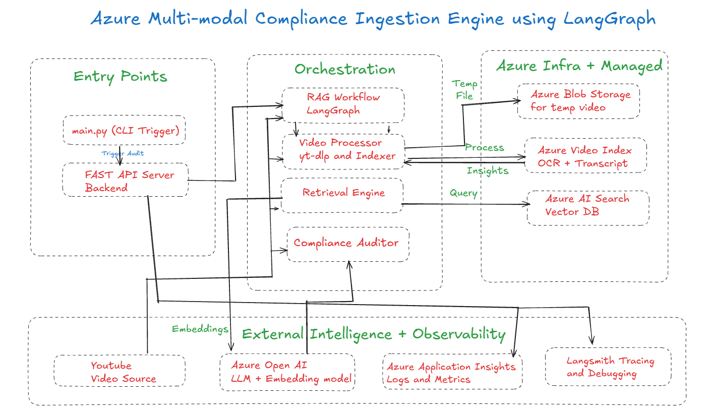

# 🛡️ Brand Guardian — AI Video Compliance Auditor

[](https://www.python.org/)
[](https://github.com/langchain-ai/langgraph)
[](https://www.trychroma.com/)
[](https://ollama.ai/)
[](https://fastapi.tiangolo.com/)
[](https://streamlit.io/)
[](LICENSE)

An intelligent, end-to-end video compliance audit pipeline designed to automatically verify social media advertisements and influencer content against official advertising standards and disclosure regulations.

**100% Free, Private & Local**: Runs entirely on local CPU using open-source models without requiring cloud subscriptions or paid API credits.

---

## 📸 System Architecture



```
[ YouTube URL ] ───► [ Local Video Indexer ] ───► [ Local RAG Auditor ] ───► [ Compliance Report ]
                            │                             │                         (PASS / FAIL)
                   ┌────────┴────────┐           ┌────────┴────────┐
                   │ faster-whisper  │           │ ChromaDB Vector │
                   │ RapidOCR Frames │           │ Ollama Reasoner │
                   └─────────────────┘           └─────────────────┘
```

---

## 🌟 Key Capabilities

- **Automated Video Ingestion**: Downloads and samples video streams locally with `yt-dlp`.
- **Multimodal Extraction**:
  - **Speech-to-Text**: High-speed offline transcription via `faster-whisper` (INT8 quantized on CPU).
  - **Visual Text Detection (OCR)**: Extracts on-screen brand mentions, hashtags, and fine-print disclaimers with `RapidOCR` and OpenCV.
- **Regulatory Retrieval-Augmented Generation (RAG)**: Indexes regulatory documentation into a persistent local `ChromaDB` vector store using ONNX embeddings.
- **Intelligent Verification**: Evaluates combined audio and visual evidence against retrieved compliance rules with a local `Ollama` language model to identify missing endorsements, misleading guarantees, and disclosure defects.
- **Dual Interfaces**:
  - **Interactive Streamlit Web Dashboard**: Visual review with real-time audit progress, metric cards, and violation severity breakdowns.
  - **Production-Ready FastAPI Service**: REST API with complete interactive Swagger documentation at `/docs`.
- **Full Observability**: Integrated support for `LangSmith` tracing and local structured logging.

---

## ⚡ Quick Start Guide

### 1. Prerequisites
- Python 3.12+ (or [uv](https://github.com/astral-sh/uv))
- [Ollama](https://ollama.ai) installed and running locally
- Pull a local model:
  ```bash
  ollama pull gemma3:1b
  ```

### 2. Installation
Clone the repository and set up dependencies:
```bash
git clone https://github.com/YOUR_USERNAME/ComplianceQaPipeline.git
cd ComplianceQaPipeline
uv sync
```

### 3. Initialize the Vector Knowledge Base
Index the regulatory compliance guidelines into your local ChromaDB vector store:
```bash
uv run python backend/scripts/index_documents.py
```

### 4. Launch the Streamlit Web Application
```bash
uv run streamlit run ui.py
```
Open **[http://localhost:8501](http://localhost:8501)** to analyze any video directly through the browser.

### 5. Run via Command-Line Interface (CLI)
```bash
uv run python main.py "https://youtu.be/dT7S75eYhcQ"
```

### 6. Start the REST API (with Swagger Documentation)
```bash
uv run uvicorn backend.src.api.server:app --reload --port 8000
```
- Interactive Swagger UI: **[http://localhost:8000/docs](http://localhost:8000/docs)**
- Health Check: **[http://localhost:8000/health](http://localhost:8000/health)**

---

## 📊 Sample Audit Output

```yaml
Video ID:    vid_361ed768
Status:      FAIL
Duration:    30.03s
Resolution:  640x360

[ VIOLATIONS DETECTED ]
- [CRITICAL] Disclosure Violation:
  Product branding displayed in an endorsement format without clear and conspicuous material connection disclosures.

[ AUDITOR SUMMARY ]
Commercial endorsement identified without mandatory material connection disclosures, requiring remediation.
```

---

## 🔭 LangSmith Tracing (Optional)

To stream execution traces and latency metrics to your LangSmith dashboard, configure your `.env` file:
```env
LANGCHAIN_TRACING_V2="true"
LANGCHAIN_API_KEY="your-api-key"
LANGCHAIN_PROJECT="brand-guardian"
```

---

## 💼 Resume Highlights (For Software / AI Engineer Portfolios)

- **Multimodal QA Pipeline**: Designed a privacy-first video compliance system using **LangGraph**, **faster-whisper**, **RapidOCR**, and **ChromaDB**, eliminating external cloud dependencies and reducing operating costs to $0.
- **Local RAG Architecture**: Implemented an offline RAG engine with ONNX embeddings to retrieve regulatory rules and enforce compliance checks with structured JSON outputs.
- **Dual Interface & API**: Developed both an interactive **Streamlit** dashboard and a **FastAPI** service documented with **Swagger/OpenAPI**.
- **Observability**: Integrated **LangSmith** tracing and structured logging for end-to-end execution monitoring.

---

## 📄 License

This project is licensed under the [MIT License](LICENSE).
